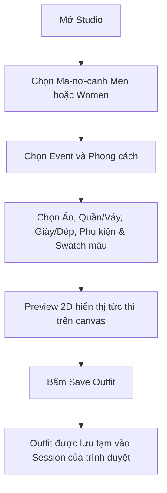
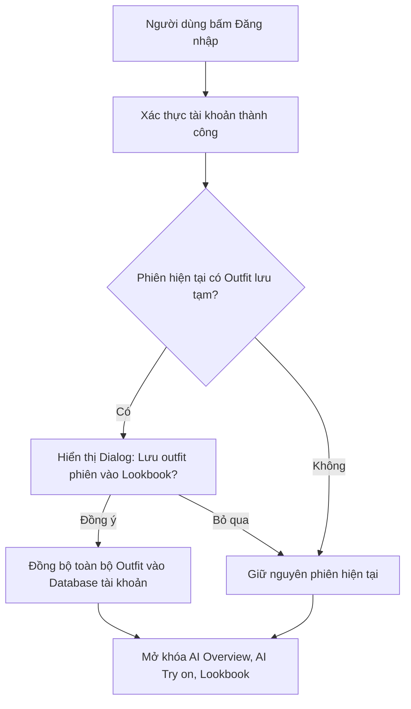
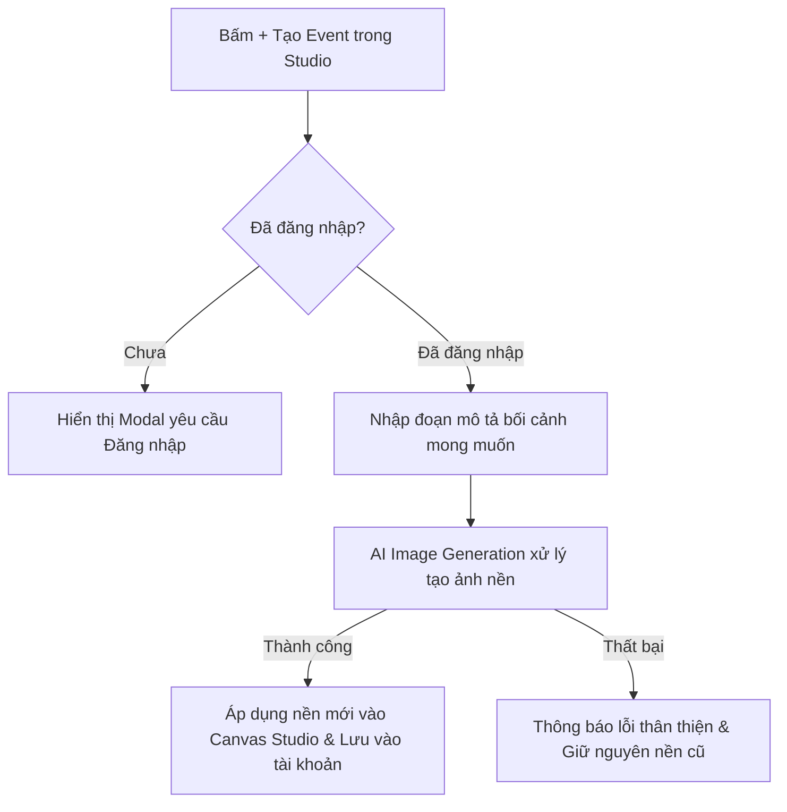
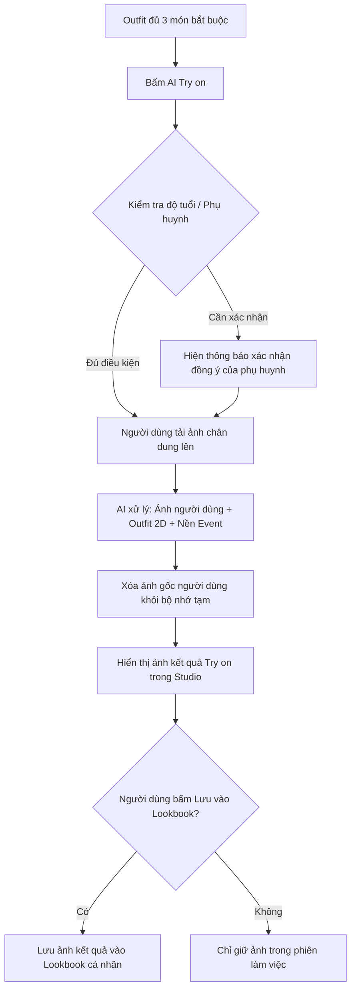
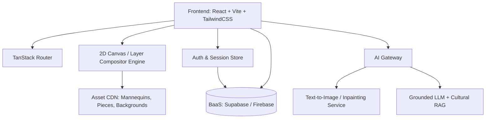

# SPECIFICATIONS — Việt phục Remix

## 1. Mục tiêu và phạm vi

**Việt phục Remix** là ứng dụng giúp học sinh, sinh viên khám phá và phối trang phục truyền thống Việt Nam (Việt phục) theo bối cảnh sự kiện và phong cách cá nhân, dung hòa giữa tính hiện đại của Gen Z và sự tôn trọng chuẩn mực văn hóa. Ứng dụng cung cấp trải nghiệm thử đồ 2D trực quan theo thời gian thực trên ma-nơ-canh, tra cứu thông tin lịch sử/văn hóa có trích dẫn nguồn, phân tích độ phù hợp bằng AI Overview, thử trang phục trên ảnh người thật (AI Try on) và lưu trữ/chia sẻ Lookbook cá nhân.

Phạm vi catalog phiên bản này được định nghĩa tại [PIECES.md](./PIECES.md), bao gồm bốn nhóm: Áo, Quần/Chân váy, Giày/Dép và Phụ kiện. Yếu tố địa phương được tích hợp trực tiếp trong thẻ thông tin văn hóa của từng trang phục (ví dụ: Áo bà ba / Khăn rằn Nam Bộ), **không** đóng vai trò bộ lọc riêng trên giao diện Studio ở phiên bản này.

### 1.1 Phân quyền người dùng

| Nhóm người dùng | Quyền hạn và phạm vi trải nghiệm |
| --- | --- |
| **Khách (Chưa đăng nhập)** | • Khám phá toàn bộ Trang chủ (SCR-01), xem các Event và Preset phối mẫu.<br>• Sử dụng Studio (SCR-02): Khám phá catalog, thử đồ 2D thời gian thực trên ma-nơ-canh Men/Women, chọn swatch màu, đổi 5 Nền Event cố định.<br>• Lưu tạm các Outfit đã phối trong phiên làm việc hiện tại (`Session`).<br>• Tải ảnh mockup 2D trên ma-nơ-canh về thiết bị cá nhân.<br>• Truy cập xem Lookbook công khai do người khác chia sẻ qua liên kết và bấm "Phối lại trong Studio". |
| **Người dùng có tài khoản** | • Toàn bộ quyền của Khách.<br>• Mở khóa **AI Overview** (đánh giá phối màu, độ phù hợp sự kiện, cảnh báo văn hóa).<br>• Mở khóa **AI Try on** (thử đồ trên ảnh chân dung cá nhân với nền và outfit đã chọn).<br>• Nhập mô tả để AI tạo Nền Event mới (Event tự nhập) và lưu vào tài khoản.<br>• Truy cập Bảng điều khiển Lookbook cá nhân (SCR-03A): Quản lý vĩnh viễn Outfit và ảnh Try-on, gom bộ sưu tập, đổi tên, so sánh đa phương án.<br>• Tạo và quản lý liên kết chia sẻ Lookbook công khai (SCR-03B) kèm quyền thu hồi tức thì và chọn lọc ảnh chia sẻ.<br>• Chuyển đổi (migrate) các Outfit lưu tạm trong phiên vào Lookbook khi đăng nhập. |

### 1.2 Thuật ngữ chuẩn

Mọi khái niệm nghiệp vụ trong tài liệu này tuân thủ định nghĩa tại [CONTEXT.md](./CONTEXT.md), bao gồm: **Piece (Mảnh phối)**, **Biến thể Piece**, **Mẫu Piece**, **Ma-nơ-canh trình bày**, **Preview 2D**, **Outfit**, **Gợi ý outfit (Preset)**, **Event cố định**, **Event tự nhập**, **Nền Event**, **AI Overview**, **AI Try on**, **Lookbook**, **Lookbook công khai** và **Phiên làm việc**.

Quyết định kiến trúc chuyển đổi từ ảnh Combination dựng sẵn sang mô hình Preview 2D Layer được ghi nhận tại [docs/adr/0001-2d-mannequin-layering.md](./docs/adr/0001-2d-mannequin-layering.md).

---

## 2. Quy tắc catalog và mô hình Preview 2D Layer

### 2.1 Cấu trúc một Outfit hoàn chỉnh

Một Outfit hợp lệ về mặt kỹ thuật để hiển thị đầy đủ, lưu trữ hoặc đưa vào AI Try on bắt buộc phải tuân thủ cấu trúc sau:

| Thành phần | Số lượng quy định | Tính chất | Ghi chú |
| --- | :---: | :---: | --- |
| **Áo** | 1 | Bắt buộc | Chọn 1 biến thể từ danh mục Áo |
| **Quần / Chân váy** | 1 | Bắt buộc | Chọn 1 biến thể từ danh mục Quần / Chân váy |
| **Giày / Dép** | 1 | Bắt buộc | Chọn 1 biến thể từ danh mục Giày / Dép |
| **Phụ kiện** | 0 – 1 | Tùy chọn | Tối đa 1 phụ kiện (hoặc không chọn) |

### 2.2 Mô hình Ma-nơ-canh và Thứ tự Xếp lớp 2D (Layer Stacking)

Để giải quyết bài toán bùng nổ tổ hợp ảnh khi có nhiều biến thể màu sắc, hệ thống áp dụng cơ chế ghép layer 2D tức thì phía client:

1. **Ma-nơ-canh trình bày**:
   - Cung cấp hai mẫu ma-nơ-canh cố định: `Men` và `Women`.
   - Cả hai đều có góc chụp chính diện chuẩn hóa, cùng tỷ lệ cơ thể và hệ tọa độ neo (anchor points) thống nhất.
   - Đây là lựa chọn trình bày thị giác, không phải ràng buộc danh tính người dùng.
2. **Quy chuẩn Asset 2D**:
   - Mỗi Biến thể Piece là một tệp hình ảnh định dạng PNG hoặc WebP với nền trong suốt (alpha channel).
   - Tọa độ, kích thước canvas của mọi asset được căn khớp hoàn toàn với ma-nơ-canh chuẩn, không yêu cầu co giãn hay xoay góc tại runtime ("Zero Runtime Transform").
   - Chi tiết về hệ tọa độ neo giải phẫu (Landmarks), kích thước canvas 3:4, hướng dẫn vẽ từng lớp và checklist nghiệm thu asset được quy định tại [ASSET_SPECIFICATIONS.md](./ASSET_SPECIFICATIONS.md).
3. **Thứ tự xếp lớp (Z-index từ dưới lên trên)**:
   - **Lớp nền (Background)**: Nền Event (nằm sau toàn bộ ma-nơ-canh).
   - **Layer 1 (Z=1)**: Ma-nơ-canh trình bày (`Men` hoặc `Women`).
   - **Layer 2 (Z=2)**: Quần / Chân váy.
   - **Layer 3 (Z=3)**: Giày / Dép.
   - **Layer 4 (Z=4)**: Áo (được đặt đè lên quần/chân váy để tà áo dài, áo tấc, áo tứ thân phủ tự nhiên bên ngoài).
   - **Layer 5 (Z=5)**: Phụ kiện (nón, khăn đóng, khăn rằn, túi, trang sức...).

### 2.3 Quản lý Biến thể Piece và Màu sắc

- **Không tô màu động (Recolor)**: Nhằm bảo toàn chất liệu vải, độ bóng gấm lụa và hoa văn dệt/thêu truyền thống, hệ thống **không** dùng thuật toán tô màu trực tiếp lên ảnh. Mỗi màu/họa tiết của một thiết kế là một **Biến thể Piece** độc lập có asset ảnh 2D dựng sẵn.
- **Trình bày trên UI**: Để giao diện gọn gàng, Studio gom các Biến thể Piece có chung thiết kế vào một card **Mẫu Piece**. Người dùng chọn màu bằng các **swatch màu** tích hợp bên trong card đó. Khi chọn swatch, asset layer tương ứng trên preview sẽ đổi ngay lập tức.

### 2.4 Nguyên tắc phối tự do và Outfit gợi ý

- **Tự do sáng tạo**: Người dùng được phép phối bất kỳ Piece nào thuộc cùng ma-nơ-canh với nhau. Hệ thống **không chặn** bất kỳ tổ hợp nào, kể cả khi có sự phối trộn phá cách giữa cổ phục và đồ hiện đại.
- **Outfit gợi ý (Preset)**: Tab `Outfit gợi ý` cung cấp các bộ phối sẵn do ban biên tập tuyển chọn (ví dụ: *Áo tấc phối quần tây Loafer*, *Áo dài cách tân phối Mary Jane*...). Khi nhấn vào một gợi ý, toàn bộ các layer tương ứng sẽ tự động nạp vào Studio; người dùng hoàn toàn có thể tiếp tục thay đổi từng món đồ hoặc đổi màu theo ý thích.

### 2.5 Bộ lọc phong cách

Studio cung cấp bộ lọc 3 chế độ phong cách:

| Phong cách | Định hướng hiển thị |
| --- | --- |
| **Truyền thống** | Ưu tiên hiển thị các Piece mang tính cổ phong, lễ nghi (Áo tấc, Ngũ thân, Váy đụp, Hài thêu, Khăn đóng...). |
| **Hiện đại** | Ưu tiên hiển thị các Piece trang phục thường nhật Gen Z (Blazer, Áo thun cổ lọ, Quần jeans baggy, Quần tây xếp ly, Sneakers...). |
| **Remix** | Hiển thị trọn vẹn catalog, khuyến khích các kết hợp giao thoa giữa truyền thống và hơi thở đương đại. |

### 2.6 Thẻ thông tin văn hóa và Nguồn kiểm chứng

Mỗi Piece hiển thị kèm một thẻ thông tin vắn tắt gồm:
- Tên trang phục / phụ kiện (kèm tên chữ Hán hoặc tên dân gian nếu có).
- Nhóm và phân loại phong cách.
- Nguồn gốc lịch sử, ý nghĩa văn hóa và hoàn cảnh sử dụng truyền thống.
- **Nguồn tham khảo đã kiểm chứng**: Ít nhất một trích dẫn rõ ràng từ bảo tàng (Bảo tàng Lịch sử Quốc gia, Bảo tàng Phụ nữ Nam Bộ...), công trình nghiên cứu trang phục uy tín (Trần Quang Đức, Đoàn Thị Tình...) hoặc tư liệu phục dựng cổ phong được thẩm định.

---

## 3. Event và nền preview

Nền Event đóng vai trò tạo bối cảnh không gian cho trang phục. Nền Event hoàn toàn độc lập với các layer trang phục 2D; việc thay đổi nền không ảnh hưởng tới các mảnh ghép outfit đang chọn.

### 3.1 Năm Event cố định

Studio tích hợp sẵn 5 Event tiêu biểu gắn liền với đời sống của người trẻ và nét văn hóa Việt:

1. **Tết Cổ Truyền**: Bối cảnh phố hoa xuân, cành đào/mai, câu đối đỏ, không gian ấm cúng.
2. **Dạ hội trường học (School Prom)**: Không gian sảnh tiệc tối sang trọng, ánh sáng lấp lánh trẻ trung.
3. **Tết Trung Thu (Mid-Autumn Festival)**: Phố đèn lồng lung linh, ánh trăng rằm truyền thống.
4. **Ngày hội văn hóa / Trường học**: Sân trường rợp bóng cây, cờ hội, gian hàng triển lãm văn hóa dân gian.
5. **Lễ cưới / Lễ gia đình**: Không gian tư gia trang trọng, phông đỏ truyền thống hoặc hoa cưới thanh lịch.

Mỗi Event cố định đi kèm một ảnh nền chuẩn hóa về tỷ lệ và ánh sáng để hòa hợp với ma-nơ-canh.

### 3.2 Event tự nhập (Custom AI Background)

- **Điều kiện**: Tính năng yêu cầu người dùng phải đăng nhập tài khoản.
- **Quy trình hoạt động**:
  1. Người dùng nhập một đoạn mô tả văn bản ngắn (ví dụ: *"Quán cà phê cổ Hội An lúc hoàng hôn"*, *"Triển lãm mỹ thuật đương đại Hà Nội"*).
  2. Hệ thống gọi AI Image Generation để tạo một hình ảnh nền mới theo tỷ lệ khung hình của Studio.
  3. Nền mới được áp dụng ngay vào canvas Studio phía sau ma-nơ-canh.
  4. Nền này được tự động lưu vào danh mục bối cảnh cá nhân của tài khoản để tái sử dụng trong các lần phối sau.
- **Xử lý sự cố**: Nếu việc tạo nền thất bại (do lỗi mạng, vi phạm chính sách nội dung hoặc lỗi dịch vụ AI), hệ thống giữ nguyên nền hiện tại và hiển thị thông báo thân thiện để người dùng thử lại.

---

## 4. Đặc tả chức năng (Functional Requirements)

### FR-01 — Studio phối đồ 2D thời gian thực

Studio là trung tâm trải nghiệm của ứng dụng:
1. Cho phép người dùng chuyển đổi ma-nơ-canh trình bày giữa `Men` và `Women`.
2. Cho phép chọn Event (5 cố định hoặc Event cá nhân đã tạo) và bộ lọc Phong cách (`Truyền thống`, `Hiện đại`, `Remix`).
3. Cung cấp 5 tab lựa chọn:
   - `Áo`
   - `Quần / Chân váy`
   - `Giày / Dép`
   - `Phụ kiện đi kèm` (có nút bấm "Bỏ chọn phụ kiện")
   - `Outfit gợi ý` (các preset phối sẵn)
4. Trên mỗi card Piece, hiển thị hình đại diện, tên và các **swatch màu**. Bấm vào swatch màu sẽ lập tức chuyển đổi Biến thể Piece tương ứng.
5. Canvas hiển thị Preview 2D cập nhật tức thì theo đúng thứ tự layer quy định ngay khi người dùng chọn/đổi Piece hoặc swatch.
6. Hiển thị trạng thái đầy đủ của Outfit: chỉ bật nút **AI Try on** và lưu vĩnh viễn khi đã chọn đủ 3 món bắt buộc (Áo, Quần/Váy, Giày/Dép).

### FR-02 — Quản lý phiên và Lưu tạm (Session Management)

1. Khách vãng lai (chưa đăng nhập) có thể bấm **Save Outfit** để lưu trang phục đang phối vào bộ nhớ tạm của phiên làm việc (`Session`).
2. Khách có thể xem danh sách các outfit đã lưu tạm trong phiên để so sánh hoặc tải ảnh mockup 2D.
3. Khi người dùng tiến hành Đăng nhập / Đăng ký tài khoản, hệ thống phát hiện các outfit đang có trong phiên và hiển thị hộp thoại:
   > *"Bạn có muốn chuyển các bộ trang phục đã phối trong phiên này vào Lookbook cá nhân không?"*
   - Nếu đồng ý: Lưu toàn bộ outfit phiên vào cơ sở dữ liệu của tài khoản.
   - Nếu từ chối: Bỏ qua, phiên tiếp tục bình thường với tài khoản mới.

### FR-03 — Trợ lý văn hóa AI Overview

Chỉ khả dụng cho người dùng đã đăng nhập. Khi người dùng phối một Outfit hoàn chỉnh, AI Overview phân tích dựa trên **tri thức văn hóa đã được thẩm định trong catalog**:

1. **Hài hòa màu sắc**: Đánh giá sự tương phản, phối màu theo ngũ hành hoặc thẩm mỹ truyền thống/hiện đại.
2. **Độ phù hợp sự kiện**: Phân tích mức độ trang trọng của outfit so với Event đang chọn (ví dụ: đi prom trường học có phù hợp không, dự lễ cưới có trang nghiêm không).
3. **Cảnh báo và giải thích văn hóa**:
   - Phân loại trạng thái: `Phù hợp` (Xanh), `Cần lưu ý` (Vàng), hoặc `Không khuyến nghị về văn hóa` (Đỏ cam).
   - Đưa ra giải thích lịch sử khách quan, mang tính chia sẻ tri thức (ví dụ: giải thích lý do không nên mặc áo yếm trần khi dự lễ cưới hay sự kiện tôn nghiêm, khuyến nghị khoác thêm áo tấc/áo đối khâm).
   - **Tuyệt đối không chặn**: Người dùng vẫn được toàn quyền giữ nguyên outfit và lưu/thử đồ.
4. Đối với người dùng chưa đăng nhập, khu vực này hiển thị khung giới thiệu tính năng kèm nút kêu gọi Đăng nhập.

### FR-04 — Thử đồ trên người thật (AI Try on)

Chỉ khả dụng cho người dùng đã đăng nhập:
1. Người dùng bấm **Try on** trong Studio khi outfit đã hoàn chỉnh.
2. Người dùng tải lên 1 ảnh chân dung/toàn thân của bản thân (hoặc chọn ảnh mẫu có sẵn).
3. Hệ thống gửi ảnh người dùng, danh sách Piece/biến thể đang chọn và Nền Event tới mô hình AI Image-to-Image / Inpainting.
4. Kết quả trả về là một bức ảnh chân thực mô phỏng người dùng đang mặc bộ trang phục trong bối cảnh nền đã chọn.
5. **Chính sách bảo mật & Vị thành niên**:
   - Ảnh gốc người dùng tải lên bị xóa khỏi bộ nhớ đệm ngay sau khi tác vụ tạo ảnh hoàn tất.
   - Ảnh kết quả chỉ lưu tạm trong phiên; chỉ được lưu dài hạn khi người dùng chủ động chọn "Lưu vào Lookbook".
   - Người dùng dưới độ tuổi quy định (học sinh nhỏ tuổi) phải có thông báo yêu cầu xác nhận sự đồng ý của phụ huynh/người giám hộ trước khi tải ảnh khuôn mặt.

### FR-05 — Quản lý, So sánh và Chia sẻ Lookbook

Dành cho người dùng có tài khoản:
1. Xem lại danh sách các Outfit 2D và các ảnh AI Try-on đã lưu vĩnh viễn.
2. Gom các outfit thành từng bộ sưu tập Lookbook theo chủ đề (ví dụ: *"Lookbook Tết 2026"*, *"Đi Prom phong cách Cổ phong"*).
3. Hỗ trợ tải toàn bộ Lookbook hoặc từng Outfit về máy dưới dạng hình ảnh chất lượng cao kèm thông tin chi tiết.
4. **So sánh đa phương án**: Chọn từ 2 đến 4 outfit để đối chiếu trực quan cạnh nhau (Side-by-side) về hình ảnh, danh sách mảnh phối, phong cách và phân tích văn hóa.
5. **Chia sẻ an toàn qua liên kết công khai (Public Link)**:
   - Mặc định mọi Lookbook là riêng tư.
   - Người dùng có thể bật tạo liên kết công khai để người khác xem trực tiếp trên web (SCR-03B).
   - **Bảo vệ khuôn mặt**: Khi chia sẻ Lookbook có chứa ảnh AI Try on của người thật, hệ thống **không** chọn các ảnh try-on này vào liên kết mặc định. Người dùng phải chủ động tích chọn từng ảnh try-on kèm thông báo cảnh báo về việc công khai hình ảnh cá nhân.
   - Chủ sở hữu có thể tắt/thu hồi liên kết công khai bất kỳ lúc nào; khi thu hồi, liên kết lập tức mất hiệu lực.
6. **Tương tác Phối lại (Remix in Studio)**: Người xem Lookbook công khai có thể nhấn nút "Phối lại trong Studio" để nạp ngay cấu trúc outfit đó vào Studio cá nhân để tiếp tục biến tấu.

---

## 5. Đặc tả giao diện chi tiết (UI Screen Specifications)

Hệ thống giao diện của Việt phục Remix gồm 3 màn hình hạt nhân: **SCR-01 (Trang chủ)**, **SCR-02 (Studio phối đồ)** và **SCR-03 (Quản lý Lookbook & Thư viện cá nhân / Trang xem công khai)**.

### SCR-01 — Trang chủ (Landing Page)

* **Mục tiêu**: Giới thiệu định vị sản phẩm "Việt phục Remix — Thổi hồn Gen Z vào di sản trang phục Việt", khơi gợi cảm hứng thời trang văn hóa và dẫn dắt người dùng chuyển đổi trực tiếp vào Studio phối đồ.
* **Đối tượng**: Mọi người dùng (Khách vãng lai, học sinh, sinh viên, người dùng đã có tài khoản).
* **Đường dẫn**: `/`

#### Bố cục và các khu vực chức năng SCR-01

```
+-----------------------------------------------------------------------------------+
|  [Logo Việt phục Remix]   Khám phá   Bối cảnh   Gợi ý phối   Lookbook   [Đăng nhập]   | (Header)
+-----------------------------------------------------------------------------------+
|  [Tag: Nền tảng phối Việt phục Gen Z]                                            |
|  H1: Thổi hồn đương đại vào di sản Việt phục                                     | (Hero)
|  Mô tả: Phối đồ 2D tức thì, chuẩn xác văn hóa, đa phong cách.   [Mini-Preview 2D] |
|  [CTA: Bắt đầu phối đồ ngay]   [Xem gợi ý phối mẫu]              (Interactive)    |
|  Thống kê: 40+ Mảnh phối  |  5 Bối cảnh  |  100% Tư liệu kiểm chứng              |
+-----------------------------------------------------------------------------------+
|  Section: Tại sao là Việt phục Remix? (3 Trụ cột giá trị)                         |
|  [Trụ cột 1: Tôn trọng văn hóa]  [Trụ cột 2: Tự do sáng tạo]  [Trụ cột 3: Trợ lý AI]  |
+-----------------------------------------------------------------------------------+
|  Section: Không gian Bối cảnh & Sự kiện (5 Event Cards Grid / Horizontal Scroll)   |
|  [Tết Cổ Truyền]  [School Prom]  [Trung Thu]  [Ngày hội trường]  [Lễ cưới gia đình] |
|  (Mỗi card có nút: "Phối đồ cho sự kiện này ->" dẫn vào SCR-02 với Event đó)      |
+-----------------------------------------------------------------------------------+
|  Section: Bộ sưu tập gợi ý nổi bật (Featured Presets)                             |
|  [Card 1: Áo tấc + Loafer]  [Card 2: Ngũ thân + Mary Jane]  [Card 3: Áo dài + Guốc]|
|  (Mỗi card có nút: "Thử outfit này trong Studio" nạp thẳng vào SCR-02)            |
+-----------------------------------------------------------------------------------+
|  Section: Trải nghiệm AI & Cam kết quyền riêng tư (Banner minh họa quy trình)     |
|  [Quy trình Try-on: Chọn đồ -> Tải ảnh chân dung -> Nhận ảnh AI chân thực]       |
|  [Cam kết: Xóa ảnh gốc ngay lập tức | Bảo vệ trẻ vị thành niên | Không train AI]   |
+-----------------------------------------------------------------------------------+
|  Footer: Về dự án | Nguồn tư liệu thẩm định (Bảo tàng...) | Điều khoản & Bảo mật  |
+-----------------------------------------------------------------------------------+
```

#### Chi tiết các thành phần trên SCR-01

| Khối giao diện | Thành phần & Trực quan | Hành vi & Tương tác |
| --- | --- | --- |
| **Thanh điều hướng (Global Navbar)** | • Logo thương hiệu: Chữ cách điệu kết hợp họa tiết kỷ hà truyền thống.<br>• Menu liên kết: `Khám phá`, `Bối cảnh`, `Gợi ý phối`, `Lookbook`.<br>• Cụm tài khoản: Nút `Đăng nhập / Đăng ký` (nếu chưa đăng nhập) hoặc Avatar + Tên người dùng kèm menu dropdown (Hồ sơ, Lookbook, Đăng xuất). | • Bấm `Studio phối đồ` hoặc `Khám phá`: Chuyển sang SCR-02.<br>• Bấm `Bối cảnh`: Cuộn mượt xuống Section Event.<br>• Bấm `Lookbook`: Nếu đã đăng nhập → SCR-03A; Nếu là khách → mở modal nhắc đăng nhập hoặc xem outfit tạm.<br>• Thanh Navbar cố định (Sticky) với hiệu ứng làm mờ nền khi cuộn trang. |
| **Hero Section** | • Headline H1: *"Thổi hồn đương đại vào di sản Việt phục"*.<br>• Sub-headline giải thích sứ mệnh kết hợp cổ phục và thời trang Gen Z.<br>• Nút CTA chính: `Bắt đầu phối đồ ngay` (nút lớn, màu thương hiệu nổi bật, icon tia chớp/mũi tên).<br>• Nút CTA phụ: `Xem gợi ý phối mẫu` (dạng outline).<br>• Khung **Hero Mini-Preview 2D**: Mô phỏng trực quan 1 ma-nơ-canh chuyển động thay đổi qua lại giữa 2 bộ outfit mẫu (ví dụ: Áo tấc tay thụng + Loafer và Áo bà ba croptop + Quần cargo túi hộp).<br>• Dải thông số: `40+ Mảnh phối`, `5 Bối cảnh văn hóa`, `100% Tư liệu kiểm chứng`. | • Bấm CTA chính: Chuyển thẳng đến SCR-02 với canvas phối đồ sẵn sàng.<br>• Bấm CTA phụ: Cuộn trang xuống khu vực Featured Presets.<br>• Khung Mini-Preview tự động chuyển outfit mỗi 4 giây hoặc khi người dùng di chuột qua (hover toggle). |
| **Trụ cột giá trị (Value Props)** | 3 thẻ thông tin (Cards) với icon minh họa:<br>1. **Tôn trọng di sản**: Mọi chi tiết tà áo, cổ áo đều có nguồn gốc bảo tàng rõ ràng.<br>2. **Sáng tạo không biên giới**: Thử nghiệm phong cách Cổ phong - Hiện đại - Remix trên ma-nơ-canh 2D tức thì.<br>3. **Trợ lý AI thông minh**: AI Overview cảnh báo văn hóa tế nhị; AI Try on thử đồ trên ảnh thật. | Hover làm nổi bật thẻ, hiển thị thêm câu trích dẫn ngắn từ cố vấn chuyên môn. |
| **Không gian Bối cảnh (Event Showcase)** | 5 Thẻ bối cảnh lớn (Cards Grid hoặc Horizontal Carousel):<br>1. *Tết Cổ Truyền* (Phố hoa đào/mai, câu đối đỏ).<br>2. *Dạ hội trường học (School Prom)* (Sảnh tiệc dạ hội ánh sáng lung linh).<br>3. *Tết Trung Thu* (Phố lồng đèn, trăng rằm).<br>4. *Ngày hội văn hóa* (Sân trường cờ hoa, gian hàng truyền thống).<br>5. *Lễ cưới / Lễ gia đình* (Không gian hôn lễ ấm cúng trang trọng).<br>Mỗi thẻ gồm: Hình nền đặc trưng, tên sự kiện, gợi ý trang phục khuyên dùng và nút `Phối đồ cho sự kiện này →`. | • Khi click nút trên một Event: Mở thẳng SCR-02 với Nền Event đó được tự động chọn sẵn trên Canvas. |
| **Bộ sưu tập gợi ý (Featured Presets)** | Danh sách các bộ preset tiêu biểu được tuyển chọn:<br>• Card gồm: Hình ảnh mockup 2D sắc nét, tên outfit (ví dụ: *"Thư sinh thời đại số"*, *"Tiểu thư xuống phố"*), nhãn phong cách (`Remix`, `Truyền thống`), tóm tắt các món đồ.<br>• Nút hành động: `Thử outfit này trong Studio`. | • Khi click `Thử outfit này`: Mở SCR-02 và nạp toàn bộ cấu trúc piece/màu của preset đó vào Studio để người dùng tiếp tục biến tấu. |
| **Banner AI & Cam kết bảo mật** | • Đồ họa minh họa luồng AI Try on: `Chọn outfit → Tải ảnh chân dung → Nhận kết quả Try-on`.<br>• Hộp cam kết bảo mật 3 điểm vàng: Xóa ảnh gốc tức thì, không huấn luyện mô hình máy học, xác nhận phụ huynh đối với học sinh nhỏ tuổi. | Giúp học sinh và phụ huynh an tâm tuyệt đối về quyền riêng tư và hình ảnh cá nhân. |
| **Chân trang (Global Footer)** | • Giới thiệu dự án phi lợi nhuận hướng tới cộng đồng trẻ yêu văn hóa Việt.<br>• Danh sách nguồn tư liệu văn hóa trích dẫn (Bảo tàng Lịch sử Quốc gia, Bảo tàng Áo dài TP.HCM, Viện Văn hóa Nghệ thuật...).<br>• Liên kết chính sách bảo mật, điều khoản sử dụng, thông tin liên hệ ban phát triển. | Footer tiêu chuẩn, minh bạch thông tin pháp lý và học thuật. |

---

### SCR-02 — Studio phối đồ (Mainframe Studio)

* **Mục tiêu**: Không gian tương tác chính để người dùng chọn mảnh phối, đổi màu swatch, xếp layer 2D tức thì trên ma-nơ-canh, đổi bối cảnh, nhận phân tích văn hóa và kích hoạt AI Try on.
* **Đối tượng**: Mọi người dùng (Khách phối tự do; người dùng đăng nhập mở khóa tính năng nâng cao).
* **Đường dẫn**: `/studio`
* **Wireframe tham chiếu**: [assets/wireframes/scr-02-mainframe.png](./assets/wireframes/scr-02-mainframe.png)

#### Bố cục và cấu trúc giao diện SCR-02

```
+-----------------------------------------------------------------------------------+
|  [Logo]   Trang chủ   [Studio - Active]   Lookbook              [User Avatar / Login] |
+-----------------------------------------------------------------------------------+
|  VÙNG TRÁI: PREVIEW & ĐIỀU KHIỂN             |  VÙNG PHẢI - TRÊN: CATALOG SELECTOR  |
|  +-----------------------------------------+ |  [Áo] [Quần/Váy] [Giày/Dép] [Phụ kiện] [Gợi ý]
|  | [Men] [Women] (Chọn ma-nơ-canh)         | |  Bộ lọc: [Tất cả] [Truyền thống] [Hiện đại]
|  | Event: [Tết] [Prom] [Trung Thu] [+Tạo]  | |  +---------------------------------+
|  | Phong cách: (o) Tất cả ( ) Cổ phong ... | |  | [ Card Mẫu Piece 1 ]            |
|  +-----------------------------------------+ |  |  - Ảnh đại diện & Tên            |
|  |                                         | |  |  - Swatches: [Đỏ][Xanh][Vàng]    |
|  |        CANVAS PREVIEW 2D                | |  +---------------------------------+
|  |     (Z-index: Nền -> Ma-nơ-canh         | |  | [ Card Mẫu Piece 2 ] ...        |
|  |      -> Quần -> Giày -> Áo -> Phụ kiện) | +------------------------------------+
|  |                                         | |  VÙNG PHẢI - DƯỚI: VĂN HÓA & AI    |
|  +-----------------------------------------+ |  +---------------------------------+
|  |  [⚡ AI Try on]        [♥ Save Outfit]  | |  | 💡 AI Overview:                 |
|  |  (Cần đủ 3 món)        (Lưu session/DB) | |  | - Hài hòa màu: Tương phản tốt   |
|  +-----------------------------------------+ |  | - Sự kiện: Phù hợp Tết          |
|                                              |  | - Văn hóa: [Phù hợp]             |
|                                              |  | Nguồn: Bảo tàng Lịch sử... [link]|
+-----------------------------------------------------------------------------------+
```

#### Chi tiết các vùng tương tác trên SCR-02

| Vùng giao diện | Thành phần & Trực quan | Hành vi & Tương tác |
| --- | --- | --- |
| **Cột bên trái: Bộ lọc & Canvas Preview** | • **Thanh chọn Ma-nơ-canh**: 2 nút tab phẳng `Men` và `Women`.<br>• **Thanh chọn Event**: Dải cuộn ngang 5 Event có sẵn + Nút `+ Tạo Event` (mở modal nhập prompt AI cho tài khoản đã đăng nhập).<br>• **Thanh chọn Phong cách**: Radio/Chips chọn `Truyền thống`, `Hiện đại`, `Remix`.<br>• **Khung Canvas Preview 2D**: Canvas kích thước chuẩn (tỷ lệ 3:4 hoặc 9:16). Xếp chồng các layer trong suốt: Nền Event → Ma-nơ-canh → Quần/Váy → Giày/Dép → Áo → Phụ kiện.<br>• **Cụm nút hành động chính**:<br>  - Nút `AI Try on` (icon tia sét): Chỉ bật khi đủ 1 Áo, 1 Quần, 1 Giày.<br>  - Nút `Save Outfit` (icon trái tim/thư viện): Cho phép lưu vào Session (khách) hoặc Database (tài khoản). | • Đổi `Men`/`Women`: Chuyển đổi ma-nơ-canh và bộ layer tương ứng.<br>• Đổi Event: Đổi hình ảnh nền canvas tức thì, giữ nguyên các layer trang phục.<br>• Nhấp `+ Tạo Event`: Nếu chưa đăng nhập → hiện modal đăng nhập; nếu đã đăng nhập → mở hộp thoại nhập prompt mô tả để AI sinh nền mới.<br>• Nhấp `Save Outfit`: Khách lưu tạm vào session; tài khoản lưu vào Lookbook.<br>• Nhấp `AI Try on`: Mở modal upload ảnh chân dung thử đồ. |
| **Cột bên phải - Trên: Catalog Selector** | • **Thanh Tabs danh mục (5 Tabs)**:<br>  1. `Áo`<br>  2. `Quần / Chân váy`<br>  3. `Giày / Dép`<br>  4. `Phụ kiện đi kèm` (có nút bấm `Bỏ chọn phụ kiện`)<br>  5. `Outfit gợi ý` (các preset phối sẵn)<br>• **Lưới danh sách Piece**: Hiển thị các card Mẫu Piece.<br>• Trên mỗi card Mẫu Piece:<br>  - Ảnh đại diện mẫu thiết kế.<br>  - Tên thiết kế (ví dụ: *Áo tấc ngũ thân*, *Quần tây xếp ly*).<br>  - Hàng **swatch màu** (các chấm tròn biểu thị màu/họa tiết có sẵn).<br>  - Nút icon `(i)` mở thẻ thông tin văn hóa nhanh. | • Bấm vào card: Chọn Piece đó vào outfit với biến thể màu mặc định.<br>• Bấm vào chấm swatch màu: Chuyển đổi Biến thể Piece sang màu đó, layer trên canvas preview cập nhật ngay lập tức (< 50ms).<br>• Bấm tab `Outfit gợi ý`: Hiển thị các preset phối sẵn, bấm vào preset sẽ nạp toàn bộ áo, quần, giày, phụ kiện của preset vào Studio. |
| **Cột bên phải - Dưới: Văn hóa & AI** | • **Khi người dùng đã đăng nhập**:<br>  - Hộp thông tin **AI Overview**: Đánh giá sự hài hòa màu sắc, tính trang trọng/phù hợp với Event đang chọn.<br>  - Huy hiệu phân loại văn hóa: `Phù hợp` (xanh lục), `Cần lưu ý` (vàng hổ phách), hoặc `Không khuyến nghị` (đỏ cam).<br>  - Đoạn giải thích ý nghĩa lịch sử và khuyến nghị giải pháp thay thế nếu có sai lệch nghi lễ.<br>  - Khối trích dẫn nguồn tham khảo có link kiểm chứng.<br>• **Khi chưa đăng nhập**:<br>  - Banner đồ họa trang nhã giới thiệu tính năng Trợ lý AI và nút kêu gọi `Đăng nhập để xem phân tích văn hóa`. | • Phân tích cập nhật tự động khi Outfit đạt trạng thái hoàn chỉnh.<br>• Không bao giờ chặn người dùng tiếp tục thao tác hay lưu outfit.<br>• Khách bấm đăng nhập sẽ mở modal Auth mà không làm mất outfit hiện hành. |

---

### SCR-03 — Quản lý Lookbook & Thư viện cá nhân

Màn hình SCR-03 phục vụ lưu trữ, quản lý, so sánh và chia sẻ thành quả sáng tạo của người dùng. Màn hình bao gồm hai phân hệ:
* **SCR-03A**: Bảng điều khiển Lookbook cá nhân (Dành cho chủ tài khoản).
* **SCR-03B**: Trang xem Lookbook công khai (Dành cho người xem qua liên kết chia sẻ).
* **Trạng thái phụ (SCR-03C)**: Dành cho Khách chưa đăng nhập truy cập `/lookbook` (Quản lý các outfit tạm trong Session).

#### Bố cục SCR-03A: Bảng điều khiển Lookbook cá nhân (Private Dashboard)

* **Đối tượng**: Người dùng đã đăng nhập.
* **Đường dẫn**: `/lookbook`

```
+-----------------------------------------------------------------------------------+
|  [Logo]   Trang chủ   Studio   [Lookbook - Active]          [Avatar / Profile Menu] |
+-----------------------------------------------------------------------------------+
|  HEADER HỒ SƠ & THỐNG KÊ                                                         |
|  [Avatar] Tên người dùng | 12 Outfit đã lưu | 4 Ảnh AI Try-on | 2 Bộ sưu tập       |
|  Cụm công cụ: [+ Phối đồ mới]  [So sánh đã chọn (0)]  [Cài đặt chia sẻ Lookbook]   |
+-----------------------------------------------------------------------------------+
|  TABS:  [ Outfit 2D (12) ]      [ Ảnh AI Try on (4) ]      [ Bộ sưu tập (2) ]     |
|  Bộ lọc: Event: [Tất cả v]   Phong cách: [Tất cả v]   Sắp xếp: [Mới nhất v]       |
+-----------------------------------------------------------------------------------+
|  LƯỚI THẺ OUTFIT 2D                                                               |
|  +------------------------+  +------------------------+  +------------------------+
|  | [x] Checkbox chọn      |  | [ ] Checkbox chọn      |  | [ ] Checkbox chọn      |
|  | [Preview 2D trên nền]  |  | [Preview 2D trên nền]  |  | [Preview 2D trên nền]  |
|  | Event: Tết | Remix     |  | Event: Prom | Cổ phong |  | Event: Cưới | Truyền t.|
|  | "Tết Phố Cổ 2026" [Pen]|  | "Dạ hội Áo tấc" [Pen]  |  | "Lễ Gia Tiên" [Pen]    |
|  | Chips: Áo ngũ thân (Đỏ)|  | Chips: Áo tấc (Xanh)   |  | Chips: Áo dài (Trắng)  |
|  |        Quần tây (Đen)  |  |        Quần lụa (Trắng)|  |        Quần lụa (Đen)  |
|  |        Loafer | Quạt gỗ|  |        Oxford | Khăn   |  |        Guốc mộc        |
|  | AI: [Phù hợp] (Xanh)   |  | AI: [Cần lưu ý] (Vàng) |  | AI: [Phù hợp] (Xanh)   |
|  | [Mở Studio] [Tải] [Xóa]|  | [Mở Studio] [Tải] [Xóa]|  | [Mở Studio] [Tải] [Xóa]|
|  +------------------------+  +------------------------+  +------------------------+
+-----------------------------------------------------------------------------------+
```

#### Chi tiết các thành phần trên SCR-03A

| Thành phần | Trực quan & Dữ liệu | Hành vi & Tương tác |
| --- | --- | --- |
| **Profile Header & Action Bar** | • Avatar, tên tài khoản, ngày tham gia.<br>• Bộ đếm: Số Outfit 2D, Số ảnh Try-on, Số Album.<br>• Nút `+ Phối đồ mới` (màu nổi bật).<br>• Nút `So sánh phương án` (hiển thị số lượng outfit đang chọn, ví dụ: `So sánh (2)`).<br>• Nút `Cài đặt chia sẻ Lookbook` (icon liên kết/chia sẻ). | • Bấm `+ Phối đồ mới`: Chuyển sang SCR-02.<br>• Bấm `So sánh`: Mở modal đối chiếu side-by-side nếu đã chọn từ 2 đến 4 outfit.<br>• Bấm `Cài đặt chia sẻ`: Mở modal cấu hình Public Link và lọc ảnh công khai. |
| **Tabs & Bộ lọc danh mục** | • 3 Tabs chính: `Outfit 2D`, `Ảnh AI Try on`, `Bộ sưu tập`.<br>• Bộ lọc con: Dropdown Event, Dropdown Phong cách (`Truyền thống`, `Hiện đại`, `Remix`), Sắp xếp theo ngày tạo. | Chuyển đổi nội dung hiển thị tức thì, hỗ trợ tìm kiếm nhanh outfit đã phối. |
| **Thẻ Outfit 2D (Outfit Card)** | • Checkbox chọn ở góc thẻ (phục vụ so sánh hoặc xóa hàng loạt).<br>• Khung ảnh render 2D trên ma-nơ-canh và nền sự kiện.<br>• Nhãn Event và nhãn Phong cách ở góc ảnh.<br>• Tên Outfit: Cho phép chỉnh sửa trực tiếp (Inline edit click-to-rename).<br>• Danh sách 4 chip hiển thị tên từng Piece kèm chấm màu biến thể.<br>• Huy hiệu AI Overview tóm tắt (`Phù hợp`, `Cần lưu ý`, `Không khuyến nghị`); hover hiển thị tooltip nội dung giải thích.<br>• Hàng nút hành động dưới đáy card:<br>  - `Mở lại trong Studio`: Nạp lại toàn bộ cấu trúc outfit vào SCR-02 để chỉnh sửa tiếp.<br>  - `Thử AI Try on`: Chuyển sang luồng thử đồ người thật với outfit này.<br>  - `Tải ảnh`: Xuất ảnh PNG độ phân giải cao.<br>  - `Xóa`: Hiện popup xác nhận xóa. | • Checkbox: Bật sáng khi click, cập nhật số lượng outfit chọn so sánh.<br>• Sửa tên outfit: Nhấn icon cây bút hoặc bấm đúp vào tên để gõ tên mới và nhấn Enter.<br>• Nút Tải ảnh: Tự động tải file ảnh ghép hoàn chỉnh về máy tính/điện thoại.<br>• Nút Xóa: Yêu cầu xác nhận "Bạn có chắc chắn muốn xóa outfit này khỏi Lookbook?". |
| **Thẻ Ảnh AI Try on (Try-on Card)** | • Khung ảnh người thật chất lượng cao tạo từ AI.<br>• Huy hiệu bảo mật: `🔒 Riêng tư trong tài khoản`.<br>• Tag liên kết tới Outfit 2D tương ứng.<br>• Ngày tạo.<br>• Nút hành động: `Xem lớn (Lightbox)`, `Tải ảnh`, `Xóa ảnh`. | • Bấm vào ảnh: Mở modal Lightbox xem ảnh kích thước đầy đủ với độ nét cao.<br>• Tải ảnh: Lưu file ảnh try-on về thiết bị.<br>• Xóa ảnh: Xóa vĩnh viễn bức ảnh khỏi cơ sở dữ liệu tài khoản. |
| **Tab Bộ sưu tập (Collections)** | • Danh sách các album do người dùng tự tạo (ví dụ: *"Ý tưởng diện Tết"*, *"Đồ đôi kỷ yếu"*).<br>• Nút `+ Tạo bộ sưu tập mới`.<br>• Mỗi album hiển thị ảnh bìa ghép 3-4 outfit và số lượng món bên trong. | Cho phép kéo thả (drag & drop) hoặc chọn outfit thêm vào từng bộ sưu tập riêng biệt. |

---

#### Bố cục SCR-03B: Trang xem Lookbook công khai (Public Shared View)

* **Đối tượng**: Bất kỳ ai truy cập qua đường dẫn chia sẻ hợp lệ (`/lookbook/share/:shareId`).
* **Tính chất**: Chế độ chỉ đọc (Read-only), an toàn quyền riêng tư, hỗ trợ tính năng "Remix in Studio".

```
+-----------------------------------------------------------------------------------+
|  [Logo Việt phục Remix]                                     [Tự tạo Lookbook của bạn] |
+-----------------------------------------------------------------------------------+
|  LOOKBOOK: "Bộ sưu tập Cổ phong đón Xuân 2026"                                    |
|  Tác giả: Minh Anh | Ngày chia sẻ: 15/01/2026 | 5 Trang phục                     |
|  Mô tả: Gợi ý các cách phối Áo tấc và Ngũ thân thanh lịch cho bạn trẻ du xuân.    |
+-----------------------------------------------------------------------------------+
|  LƯỚI OUTFIT CÔNG KHAI                                                            |
|  +------------------------+  +------------------------+  +------------------------+
|  | [Ảnh Preview 2D]       |  | [Ảnh Preview 2D]       |  | [Ảnh AI Try on]        |
|  | Event: Tết Cổ Truyền   |  | Event: Dạ hội Prom     |  | (Chỉ hiện nếu chủ sở   |
|  | "Dạo Phố Hoa Xuân"     |  | "Áo Tấc Ánh Đêm"       |  |  hữu chủ động duyệt)   |
|  | - Áo tấc (Xanh cổ vịt) |  | - Áo tấc (Đen tuyền)   |  | Event: Tết Cổ Truyền   |
|  | - Quần lụa (Trắng)     |  | - Quần tây (Xếp ly)    |  |                        |
|  | - Loafer da đen        |  | - Loafer (Bóng)        |  |                        |
|  | [✨ Phối lại outfit này]|  | [✨ Phối lại outfit này]|  | [🔍 Xem ảnh lớn]       |
|  +------------------------+  +------------------------+  +------------------------+
+-----------------------------------------------------------------------------------+
|  Banner chân trang: Yêu thích những thiết kế này?                                 |
|  [ 👉 Mở Studio tự tay phối đồ ngay ]                                             |
+-----------------------------------------------------------------------------------+
```

#### Chi tiết tính năng trên SCR-03B

1. **Hiển thị thông tin minh bạch**: Tiêu đề bộ sưu tập, tên tác giả (hoặc biệt danh), ngày xuất bản và lời nhắn chia sẻ.
2. **Nút "✨ Phối lại outfit này trong Studio (Remix in Studio)"**:
   - Xuất hiện trên từng thẻ outfit 2D.
   - Khi người xem bấm vào nút này: Hệ thống điều hướng ngay sang Studio (SCR-02) và **tự động nạp toàn bộ cấu trúc Piece, màu sắc và Nền Event** của outfit đó vào Canvas. Người xem có thể lập tức bắt đầu sáng tạo thêm dựa trên outfit của bạn bè!
3. **Cơ chế thu hồi (Revocation State)**:
   - Nếu chủ sở hữu tắt chia sẻ hoặc xóa liên kết: Bất kỳ ai truy cập URL cũ sẽ thấy màn hình thông báo:
     > *"Lookbook này hiện không còn được chia sẻ công khai hoặc đã được chủ sở hữu thu hồi liên kết."* kèm nút bấm `Trở về Trang chủ`.

---

#### Chi tiết các Modal phụ trợ trên SCR-03

##### 1. Modal So sánh đa phương án (Side-by-side Comparison Modal)

Kích hoạt khi người dùng tích chọn từ 2 đến 4 outfit trên SCR-03A và bấm `So sánh phương án`:

```
+-----------------------------------------------------------------------------------+
|  SO SÁNH PHƯƠNG ÁN PHỐI ĐỒ                                                  [ X ] |
+-----------------------------------------------------------------------------------+
|  Tiêu chí đối chiếu    | Phương án A: "Dạo Tết"       | Phương án B: "Prom Night" |
+------------------------+------------------------------+---------------------------+
|  Hình ảnh trực quan    | [Ảnh Preview 2D trên nền]    | [Ảnh Preview 2D trên nền] |
|  Bối cảnh (Event)      | Tết Cổ Truyền                | Dạ hội trường học         |
|  Phong cách chủ đạo    | Remix                        | Cổ phong truyền thống     |
|  Áo                    | Áo ngũ thân tay chẽn (Đỏ đô) | Áo tấc tay thụng (Xanh)   |
|  Quần / Chân váy       | Quần tây xếp ly (Đen)        | Quần lụa ống suông (Trắng)|
|  Giày / Dép            | Giày Sneaker trắng retro     | Giày da Loafer cổ điển    |
|  Phụ kiện              | Khăn đóng lụa (Đen)          | Quạt xếp giấy hoa văn     |
|  Đánh giá văn hóa AI   | 🟢 Phù hợp không khí xuân    | 🟡 Lưu ý: Áo tấc trang    |
|                        | Màu sắc hài hòa, trẻ trung   | trọng, hợp prom dạ tiệc   |
+------------------------+------------------------------+---------------------------+
|  Thao tác              | [ Mở phương án A vào Studio] | [ Mở phương án B vào Studio]|
+-----------------------------------------------------------------------------------+
```

##### 2. Modal Cài đặt chia sẻ & Bảo vệ quyền riêng tư (Share Settings Modal)

Kích hoạt khi người dùng bấm `Cài đặt chia sẻ Lookbook` trên SCR-03A:

1. **Công tắc chia sẻ công khai**:
   - Switch Toggle: `Bật liên kết công khai`.
   - Khi Bật: Hiển thị liên kết dạng `https://vietphuc-remix.vn/lookbook/share/lb_8f29d1`.
   - Cụm nút: `Sao chép liên kết` (Copy) và nút cảnh báo màu đỏ `Hủy liên kết (Revoke Link)` (vô hiệu hóa tức thì liên kết hiện tại).
2. **Bộ lọc bảo vệ quyền riêng tư (Privacy Granularity Selector)**:
   - Danh sách kiểm tra (Checklist) toàn bộ các mục trong Lookbook:
     - Các Outfit 2D (trên ma-nơ-canh): **MẶC ĐỊNH ĐƯỢC TÍCH CHỌN**.
     - Các Ảnh AI Try-on (có ảnh chân dung khuôn mặt thật): **MẶC ĐỊNH BỎ CHỌN (UNCHECKED)**.
   - **Xác nhận nghiêm ngặt khi công khai ảnh người thật**:
     - Nếu người dùng bấm tích chọn vào một ảnh AI Try on, hệ thống lập tức mở hộp thoại cảnh báo:
       > ⚠️ **Cảnh báo quyền riêng tư hình ảnh**
       >
       > Bức ảnh này chứa chân dung/khuôn mặt người thật. Bạn có chắc chắn muốn cho phép bất kỳ ai có liên kết đều có thể xem bức ảnh này không?
       >
       > `[ Hủy bỏ ]`   `[ Tôi hiểu và đồng ý chia sẻ ]`
     - Chỉ khi người dùng bấm đồng ý, bức ảnh đó mới được đưa vào danh sách hiển thị trên liên kết công khai.
3. **Quyền của người xem**:
   - Checkbox: `Cho phép người xem bấm "Phối lại trong Studio (Remix)"` (mặc định Bật).

---

#### SCR-03C — Trạng thái Khách vãng lai xem Outfit tạm trong phiên

Khi người dùng chưa đăng nhập bấm vào mục `Lookbook` trên thanh điều hướng hoặc truy cập `/lookbook`:
- Hệ thống hiển thị giao diện thông báo nhẹ nhàng:
  - Banner trên cùng: *"Bạn đang ở chế độ Khách. Dưới đây là các bộ trang phục bạn đã phối trong phiên làm việc này."*
  - Nút kêu gọi hành động: `Đăng ký / Đăng nhập ngay để lưu trữ vĩnh viễn và tạo link chia sẻ Lookbook`.
  - Lưới hiển thị các Outfit 2D đã lưu tạm trong Session hiện tại.
  - Cho phép khách xem ảnh 2D, tải ảnh PNG về máy hoặc xóa outfit tạm.
  - Các tính năng AI Try on, So sánh nâng cao, và Chia sẻ công khai được hiển thị dưới dạng khóa kèm icon ổ khóa; khi bấm vào sẽ mở modal đăng nhập.

---

## 6. Luồng người dùng chính (User Flows)

### 6.1 Khách vãng lai phối đồ 2D và lưu tạm



### 6.2 Đăng nhập và chuyển đổi dữ liệu phiên



### 6.3 Tạo Nền Event mới bằng AI



### 6.4 Trải nghiệm AI Try on an toàn



---

## 7. Yêu cầu phi chức năng (Non-Functional Requirements)

### 7.1 Tính chuẩn xác và Tôn trọng văn hóa

- **Cơ sở tri thức có căn cứ**: Mọi thông tin mô tả nguồn gốc, ý nghĩa lịch sử trên thẻ thông tin và mọi lập luận trong AI Overview đều phải dựa trên cơ sở dữ liệu đã qua thẩm định từ các nguồn uy tín, tuyệt đối không để AI tạo ra các khẳng định lịch sử sai lệch hay suy đoán vô căn cứ.
- **Thái độ trung lập và văn minh**: Các cảnh báo văn hóa trong AI Overview phải mang tính chất cung cấp góc nhìn và gợi ý giải pháp thay thế, tránh dùng từ ngữ phán xét hay áp đặt định kiến lên sở thích cá nhân của người dùng.

### 7.2 Quyền riêng tư và Bảo vệ người dùng nhỏ tuổi

- **Xử lý ảnh khuôn mặt nghiêm ngặt**: Ảnh gốc tải lên cho AI Try on phải được xóa tức thì sau khi quá trình sinh ảnh kết thúc. Không lưu trữ ảnh người dùng cho mục đích thương mại hoặc huấn luyện mô hình máy học mà không có thỏa thuận riêng.
- **Nguyên tắc chia sẻ có chủ quyền**: Khi chia sẻ liên kết Lookbook công khai, hình ảnh AI Try on chứa khuôn mặt người dùng mặc định **không** được chia sẻ, trừ khi người dùng chủ động đánh dấu cho phép kèm cảnh báo rõ ràng.
- **Bảo vệ người dùng vị thành niên**: Thiết lập xác nhận của phụ huynh/người giám hộ đối với người dùng thuộc nhóm học sinh nhỏ tuổi khi sử dụng các tính năng tải ảnh cá nhân.

### 7.3 Hiệu năng và Tối ưu trải nghiệm đồ họa

- **Độ trễ phản hồi ghép layer**: Vì sử dụng mô hình layer 2D, thời gian cập nhật hiển thị khi người dùng đổi Piece hoặc chọn swatch màu phải diễn ra tức thì (độ trễ thị giác < 50ms).
- **Tối ưu hóa asset**: Toàn bộ asset PNG/WebP phải được nén tối ưu (kích thước mỗi piece không vượt quá 200KB) và triển khai cơ chế Preload (tải trước) đối với 2 ma-nơ-canh và các layer cơ bản để tránh giật lag hay trắng hình khi tương tác.

---

## 8. Tiêu chí nghiệm thu (Acceptance Criteria)

| ID | Tiêu chí nghiệm thu chi tiết |
| --- | --- |
| **AC-01** | Người dùng có thể chọn chuyển đổi giữa 2 ma-nơ-canh trình bày `Men` và `Women`, chọn 1 trong 5 Event cố định và chọn 1 trong 3 phong cách (`Truyền thống`, `Hiện đại`, `Remix`). |
| **AC-02** | Studio cung cấp đầy đủ 5 tab: `Áo`, `Quần / Chân váy`, `Giày / Dép`, `Phụ kiện đi kèm` (có nút bỏ chọn) và `Outfit gợi ý`. |
| **AC-03** | Một Outfit chỉ được tính là hoàn chỉnh khi có đủ: đúng 1 Áo, đúng 1 Quần/Váy, đúng 1 Giày/Dép và tối đa 1 Phụ kiện. |
| **AC-04** | Preview 2D hiển thị bằng cách xếp chồng các asset nền trong suốt đúng thứ tự z-index: Nền Event (dưới cùng) → Ma-nơ-canh → Quần/Chân váy → Giày/Dép → Áo → Phụ kiện. |
| **AC-05** | Card Mẫu Piece hiển thị các swatch màu đại diện cho các Biến thể Piece; bấm vào swatch màu sẽ cập nhật asset layer trên ma-nơ-canh ngay lập tức. |
| **AC-06** | Thao tác đổi Event chỉ thay đổi hình ảnh Nền Event phía sau, giữ nguyên toàn bộ các layer trang phục đang phối trên ma-nơ-canh. |
| **AC-07** | Khách chưa đăng nhập có thể phối đồ, xem preview 2D, tải ảnh 2D và bấm Save Outfit để lưu tạm trong phiên làm việc. |
| **AC-08** | Khi đăng nhập, hệ thống phát hiện và hiển thị hộp thoại cho phép chuyển toàn bộ outfit lưu tạm trong phiên vào Lookbook tài khoản. |
| **AC-09** | Các tính năng **AI Overview**, **AI Try on**, **Tạo Event tự nhập** và **Quản lý Lookbook** bắt buộc phải đăng nhập; khi khách bấm vào sẽ hiển thị lời mời đăng nhập mà không làm mất outfit hiện tại. |
| **AC-10** | Event tự nhập tạo được nền mới từ mô tả văn bản, tự động áp dụng vào Studio và lưu vào danh mục nền của tài khoản; nếu lỗi thì giữ nguyên nền cũ. |
| **AC-11** | AI Overview đánh giá màu sắc, độ phù hợp sự kiện và phân loại cảnh báo (`Phù hợp`, `Cần lưu ý`, `Không khuyến nghị`) dựa trên tri thức đã thẩm định; không chặn thao tác lưu hay phối đồ của người dùng. |
| **AC-12** | Mỗi thẻ thông tin trang phục đều hiển thị ít nhất một nguồn tham khảo lịch sử/văn hóa đã qua kiểm chứng. |
| **AC-13** | AI Try on nhận ảnh chân dung, outfit và nền event để sinh ảnh kết quả; ảnh gốc bị xóa ngay sau khi tạo; ảnh kết quả lưu tạm trừ khi người dùng chủ động chọn lưu vào Lookbook; có xác nhận phụ huynh đối với học sinh nhỏ tuổi. |
| **AC-14** | Lookbook hỗ trợ xuất ảnh, bật/thu hồi liên kết công khai; ảnh AI Try on chứa khuôn mặt người dùng mặc định không được đưa vào liên kết công khai trừ khi người dùng tích chọn chủ động kèm xác nhận cảnh báo. |
| **AC-15** | Trang chủ (SCR-01) cho phép người dùng xem thông điệp, khám phá 5 bối cảnh văn hóa và các preset mẫu; bấm "Phối đồ cho sự kiện này" hoặc "Thử outfit này trong Studio" sẽ chuyển sang Studio (SCR-02) và tự động nạp thiết lập tương ứng. |
| **AC-16** | Người xem trang Lookbook công khai (SCR-03B) có thể bấm "Phối lại trong Studio (Remix in Studio)" để nạp cấu trúc trang phục sang Studio của người xem để tiếp tục sáng tạo. |
| **AC-17** | Khi khách chưa đăng nhập truy cập trang Lookbook (SCR-03C), hệ thống hiển thị danh sách các outfit đã lưu tạm trong phiên và đưa ra nút kêu gọi đăng nhập để lưu trữ vĩnh viễn. |

---

## 9. Định hướng kỹ thuật (Technical Architecture)



| Tầng kiến trúc | Đề xuất giải pháp kỹ thuật | Ghi chú & Trách nhiệm |
| --- | --- | --- |
| **Frontend** | React 18+ với **Vite**, TypeScript, TailwindCSS. | Đảm bảo tốc độ render nhanh, code gọn và trải nghiệm mượt mà cho học sinh, sinh viên trên cả máy tính lẫn thiết bị di động. |
| **2D Layer Renderer** | HTML5 Canvas hoặc CSS Layer Compositor (Absolute positioning + z-index). | Ghép layer các asset PNG/WebP theo tọa độ chuẩn hóa; hỗ trợ xuất canvas ra file ảnh PNG chất lượng cao để người dùng tải về. |
| **Quản lý trạng thái** | Zustand (quản lý Outfit hiện tại, Session tạm) + TanStack Query (caching dữ liệu catalog, lookbook). | Tách bạch giữa trạng thái phiên của khách và dữ liệu đồng bộ khi đăng nhập. |
| **Backend & Cơ sở dữ liệu** | **Supabase** hoặc **Firebase** (quyết định cụ thể tại pha triển khai). | Cung cấp Authentication (Google, Email), Database (lưu catalog, tài khoản, Lookbook, Event nền riêng), và Storage. |
| **Dịch vụ AI** | • **AI Image Generation**: Phục vụ Event tự nhập (Text-to-Image) và AI Try on (Inpainting/Image-to-Image).<br>• **Grounded LLM / RAG**: Phục vụ AI Overview, truy vấn trực tiếp trên knowledge base văn hóa đã kiểm chứng. | Module AI độc lập, có thể tích hợp qua API của Google Vertex AI / Gemini hoặc dịch vụ tương đương. |
| **Lưu trữ & CDN** | Cloudflare R2 / AWS S3 + Cloudflare CDN. | Phân phối các file asset 2D trong suốt và nền sự kiện với độ trễ tối thiểu và tối ưu caching. |
| **Triển khai (Hosting)** | Vercel / Netlify cho Frontend SPA. | Tự động hóa CI/CD, tối ưu hóa tốc độ tải trang toàn cầu. |
